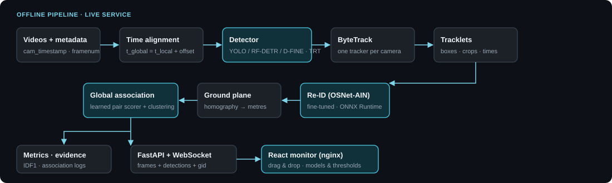

<div align="center">

# MTMC — Multi-Camera Vehicle Tracking

**Vehicle detection, tracking and cross-camera re-identification, with TensorRT inference, a learned association stage and a real-time web monitor.**
Built and measured on **CityFlowV2** (AI City Challenge 2022, Track 1).

🇬🇧 **English** · 🇧🇷 [Português (Brasil)](README.pt-BR.md)

[](LICENSE)




</div>

A modular pipeline that tracks vehicles across multiple cameras: temporal alignment of videos, detection + per-camera ByteTrack, tracklets, **vehicle Re-ID**,
global association with traceable evidence, evaluation against ground truth, diagnostic videos and a **real-time web monitor** with a read-only models-and-thresholds
panel (`GET /api/runtime`).

> **Honest status:** it works end to end (offline and live, on GPU with TensorRT), but cross-camera association quality is still modest. With the fine-tuned Re-ID and the
> improved association, global IDF1 is ≈ 0.65–0.69 on S01 (the scene where thresholds were tuned) and ≈ 0.42–0.46 on S02 (a scene not used for tuning).
> See [Results](#results) and [Limitations](#limitations). Most of the deeper documentation (`docs/`, `frontend/`, `reid_training/`) is written in Portuguese.

## Contents
- `mtmc/` — Python package (CLI `python -m mtmc ...`): `videos`, `metadata`, `detectors`, `detector_export*`, `local_tracker`, `detect_track`, `tracklets`, `reid`,
  `calibration`, `association`, `pair_scorer`, `cluster`, `live`, `live_assoc`, `server`, `runtime_info`, `evaluation`, `diagnose`, `reid_check`, `detector_bench*`, `visualize`.
- `frontend/` — web monitor (React + TypeScript + Vite + Tailwind + shadcn/ui), an independent Docker service ([frontend/README.md](frontend/README.md), Portuguese).
- `reid_training/` — Re-ID fine-tuning on the CityFlowV2 ground truth (S03/S04/S05 for training; S01/S02 held out for evaluation): [reid_training/README.md](reid_training/README.md).
- `configs/` — YAML (`s01_cityflow.yaml`, `s02_cityflow.yaml`, `live_trt_s01.yaml`, `exp_*.yaml`, `detector_bench.yaml`).
- `docs/` — [DIAGNOSTICO.md](docs/DIAGNOSTICO.md) (oracle diagnosis) and [ASSOCIACAO.md](docs/ASSOCIACAO.md) (association improvements).
- `tests/` — 88 backend tests (synthetic, independent of the videos). `outputs/results/` — measured results (JSON).

## Requirements
Docker with an NVIDIA GPU (tested: RTX 2060 6 GB, CUDA 13 driver, Docker Desktop/WSL2). The image (`Dockerfile`) ships PyTorch 2.7 + CUDA 12.6, Ultralytics 8.4,
TensorRT 10, onnxruntime-gpu, RF-DETR and `transformers`.
**Dataset:** [AI City Challenge 2022 Track 1 (CityFlowV2)](https://www.aicitychallenge.org/) — not redistributed here (its own license); download it and point `AICITY_DIR` to it.
**Weights:** see [models/README.md](models/README.md).

## Quick start
```bash
docker compose build mtmc                       # single image (CLI, API, tests, benchmark)
docker compose run --rm tests                   # 88 tests
# weights: put yolov8n.pt/yolov8l.pt and the Re-ID ONNX into models/ (see models/README.md)
docker compose run --rm mtmc run -c configs/s01_cityflow.yaml --no-viz        # full pipeline on S01 + metrics vs ground truth
docker compose up -d --build                    # live API + frontend (http://localhost:8080)
MTMC_CONFIG=configs/live_trt_s01.yaml docker compose up -d mtmc-api   # live, with the TensorRT detector
```
`AICITY_DIR` (default `D:/AICity22_Track1_MTMC_Tracking`), `FRONTEND_PORT` (8080) and `API_PORT` (8000) are compose variables (a `.env` file in the repo root is read automatically).
CLI commands: `inspect`, `detect`, `tracklets`, `associate`, `evaluate`, `visualize`, `run`, `serve`, `reid-check`, `tune`, `diagnose`, `train-scorer`, `snapshot`.
Without GPU/Docker there is a CPU mode (venv with CPU PyTorch; with `torch 2.4.0+cpu` on Windows you need `detector.disable_mkldnn: true`, because oneDNN produced absurd,
non-deterministic outputs).

## CityFlowV2 data and verified semantics
| Item | Finding |
|---|---|
| `cam_timestamp` | **start** instants of each video, in seconds (dataset ReadMe item 13). Videos may have skipped/stuck frames, so a constant offset is an approximation |
| `cam_framenum` | **total** frame count (verified by decoding the 5 S01 cameras) |
| `calibration.txt` | homography: `inv(H)` maps pixel → (lat, lon) (checked against the GPS centre in the ReadMe); reprojection error 5–11 px |
| GT (`gt/gt.txt`) | MOTChallenge with global IDs, **only vehicles seen by ≥ 2 cameras** |
| `cam_loc/*.png` | illustrative map without scale/coordinates; not used for association |

`t_global = frame/fps + camera_offset`. Frames with the same index are **not** treated as simultaneous.

## Results
Every number below was measured here (files in [`outputs/results/`](outputs/results/)). Global IDF1 is our own implementation (ROI + only IDs seen by ≥ 2 cameras, IoU ≥ 0.5; it is **not**
the official `eval.py`); HOTA was not computed.

### Re-ID (OSNet-AIN `vehicle-reid-0001`, ONNX, GPU)
On 1197 GT crops (95 vehicles, 5 S01 cameras): RGB input; AUC 0.951; rank-1 0.687; mAP 0.513 (BGR: 0.924 / 0.594). Mean cosine: same vehicle 0.42; different vehicles 0.10
(p90 0.24) ⇒ appearance thresholds ≈ 0.15. Trained on VeRi (domain gap).

**Fine-tuned Re-ID (`reid_training/`)**, evaluated on S01/S02 (held out from training): rank-1 0.677 → 0.835 (S01) and 0.635 → 0.814 (S02); mAP 0.453 → 0.683 and 0.504 → 0.723.
End to end (YOLOv8n TRT, thresholds chosen on S01): IDF1 0.613 → **0.652** (S01) and 0.383 → **0.424** (S02); IDR 0.650 → 0.725 and 0.457 → 0.500.
Details and caveats in [reid_training/RESULTS.md](reid_training/RESULTS.md).

### Learned association (pairwise logistic scorer + global clustering)
After the [diagnosis](docs/DIAGNOSTICO.md) (a perfect Re-ID did not improve IDF1; the strict class rule was the largest loss), the association rules were reworked
(`association.method: learned`): class becomes a feature instead of a veto, a learned pair score uses ground-plane geometry, and hierarchical clustering applies a veto and
at most one observation per camera. Clean test (model trained on S01, evaluated on S02): IDF1 **0.424 → 0.458**; grouping classes in the original rules: 0.437.
On S01 the improved rules reach 0.675 (in-sample). Details, results and caveats in [docs/ASSOCIACAO.md](docs/ASSOCIACAO.md).

### Full pipeline (YOLOv8n detector, thresholds tuned on S01)
| Scene | IDF1 | IDP | IDR | pair precision / recall |
|---|---|---|---|---|
| S01 (tuned on it) | 0.635 | 0.59 | 0.69 | 93 % / 51 % |
| S02 (not used for tuning) | 0.39 | 0.34 | 0.46 | 81 % / 48 % |

The spatial cue (homography, 80 m) adds ≈ +3 IDF1 points on S01 (0.60 without it). S02 has only 112 tracklets with GT.

### Larger detectors + TensorRT FP16 (RTX 2060)
Benchmark on 1717 GT frames (S01+S02), full 1080p frame including pre/post-processing, 544×960 input (DETRs: 704² / 640²). Recall = IoU ≥ 0.5, conf ≥ 0.25,
class-agnostic. Partial AP50 is only for ranking (incomplete GT).

| Model (backend) | recall | partial AP50 | boxes/frame | p50 latency | fps | VRAM |
|---|---|---|---|---|---|---|
| YOLOv8n (PyTorch FP16) | 0.867 | 0.577 | 9.0 | 24.8 ms | 40 | 74 MB |
| YOLOv8n (TensorRT FP16) | 0.870 | 0.567 | 9.1 | 17.4 ms | 58 | 84 MB |
| YOLOv8l (TRT) | 0.893 | 0.606 | 10.5 | 20.9 ms | 48 | 206 MB |
| YOLOv9-E (TRT) | 0.885 | 0.593 | 10.5 | 25.4 ms | 39 | 490 MB |
| YOLOv10-L (TRT) | 0.885 | 0.596 | 9.9 | 21.4 ms | 47 | 194 MB |
| YOLOv10-X (TRT) | 0.890 | 0.596 | 10.2 | 22.5 ms | 44 | 212 MB |
| YOLOv12-X (TRT) | 0.886 | 0.611 | 10.0 | 32.0 ms | 31 | 344 MB |
| RF-DETR-M (TRT) | 0.880 | 0.200* | 13.3 | 28.3 ms | 35 | 480 MB |
| RF-DETR-L (TRT) | 0.882 | 0.164* | 13.9 | 22.5 ms | 44 | 372 MB |
| D-FINE-L (TRT) | 0.867 | 0.176* | 29.3 | 25.9 ms | 39 | 142 MB |
| D-FINE-X (TRT) | 0.888 | 0.233* | 28.4 | 26.7 ms | 38 | 284 MB |

\* DETRs output many low-confidence boxes on unannotated vehicles, which partial AP penalises. YOLOv12-L with the original weights does not load in Ultralytics (`AAttn` has no `qkv`):
omitted. Latencies are dominated by CPU pre-processing of the 1080p frame, not by the GPU. FP16 export uses our own builder (`detector_export.py`) because Ultralytics 8.4's
`format="engine"` path requires `nvidia-modelopt`.

**Impact on the full pipeline** (same Re-ID, thresholds and tracker; only the detector changes):

| Detector | S01 IDF1 | S01 IDR | S01 local ID switches | S02 IDF1 | S02 IDR | S02 pair recall |
|---|---|---|---|---|---|---|
| YOLOv8n | **0.613** | 0.650 | 49 | **0.383** | 0.457 | 0.45 |
| YOLOv8l | 0.591 | 0.695 | 17 | 0.330 | 0.451 | 0.50 |
| YOLOv9-E | 0.547 | 0.696 | 13 | 0.325 | 0.441 | 0.71 |
| YOLOv12-X | 0.584 | 0.703 | 9 | 0.356 | 0.486 | 0.71 |
| RF-DETR-L | 0.556 | 0.705 | 22 | 0.318 | 0.452 | 0.85 |
| D-FINE-X (conf 0.25 / 0.4 / 0.5) | 0.392 / 0.424 / 0.463 | 0.52–0.58 | 1262 / 889 / 618 | — | — | — |

**Reading:** larger detectors do **not** improve global IDF1 on this ground truth. They raise identity recall (IDR), stabilise local tracking (fewer ID switches) and improve cross-camera
association (pair recall 0.71–0.85 on S02 vs 0.45), but they also detect **unannotated** vehicles (the GT only covers vehicles seen by ≥ 2 cameras), which lowers precision (IDP) and therefore
IDF1. D-FINE needs tracker tuning (many unstable boxes per frame). Association thresholds were not re-tuned per detector.

### Live (5 cameras, RTX 2060)
YOLOv8-L TensorRT FP16 + ByteTrack + Re-ID + live association: ≈ 8 processed fps per camera (≈ 40 fps total; remaining frames are dropped to keep up with real time), association round ≈ 1.8 s.
Before (YOLOv8n PyTorch, 960 px): ≈ 5 fps and 5.6 s. GPU inference is serialised by a lock (several threads initialising TensorRT engines together caused `CUDA error ... during capture`).
Live quality was not measured against GT.

## Web monitor
The monitor was modernised: drag-and-drop to swap cameras (order persisted, no stream remounting), collapsible and resizable side bars, a grid that maximises video area, per-camera controls on hover, a metrics bar
and keyboard shortcuts. A read-only panel shows the loaded models, thresholds and parameters (configured vs. applied, as reported by the running objects). Details, persistence and limitations in
[frontend/README.md](frontend/README.md) (Portuguese).

## Global association
For each pair of tracklets from different cameras: temporal relation (simultaneous/transition), class compatibility and decisive cues — **appearance** (Re-ID cosine) and **spatial** (homography to a
metric plane, or configured zones/transitions). A failed available cue rejects the pair; no decisive cue ⇒ `insufficient_evidence`; close-scoring candidates ⇒ `ambiguous`; never two observations of the
same camera in one identity. Every decision and its evidence is stored in `association_decisions.jsonl` / `global_identities.json`. Live (`server.live_association`), `mtmc/live_assoc.py` re-runs the same logic
every ~2 s with stable IDs; only vehicles linked across ≥ 2 cameras get a `gid` (it can change between rounds). The learned method (`association.method: learned`) is described above and in [docs/ASSOCIACAO.md](docs/ASSOCIACAO.md).

## Configuration
Everything is YAML (`extends:` inherits another file). Main blocks: `cameras`, `metadata`, `timestamp`/`framenum`, `detector` (`type: ultralytics_track | ultralytics | rfdetr | dfine`, `trt: true`, `imgsz`, `conf`,
`classes`), `tracker`, `reid` (`model`, `preprocess`, `input_size`), `spatial` (`calibration`, `zones`, `transitions`, `max_ground_dist`), `association` (`method`, `appearance_threshold`, `appearance_scale`,
`accept_score`, `scorer`, ...), `evaluation` (`gt_dir`, `roi_pattern`), `tuning.grid`, `server` (`live_association`, ...). Adding/removing cameras only means editing `cameras:`.

## Tests
`docker compose run --rm tests` → 88 pass (metadata parsing, temporal alignment, multiple cameras, independent local tracking, correct/incorrect/ambiguous/no-Re-ID association, evaluation, streaming API,
live associator, ByteTrack, calibration, diagnosis, learned association). Frontend: 70 Vitest + 21 Playwright tests (see `frontend/README.md`). Detection/tracking tests use a fake YOLO for the flow;
TensorRT, RF-DETR, D-FINE and the real Re-ID are only exercised by the benchmarks and real runs.

## Limitations
- Global IDF1 is modest and scene-dependent (S01 ≈ 0.65–0.69 tuned; S02 ≈ 0.42–0.46). Thresholds were tuned on S01.
- IDF1 is our own implementation (not the official one); HOTA is missing; partial GT underestimates the precision of more sensitive detectors.
- Re-ID base model trained on VeRi (then fine-tuned); calibration error of 5–11 px; skipped frames in the videos.
- Live: ≈ 8 fps/camera on the RTX 2060 (does not reach 10 fps with 5 cameras); quality not measured against GT; `gid` can change; the learned association was not validated live.
- D-FINE and YOLOv12-L (original weights) were not usable in this setup. No authentication/TLS on the web service.

## License and credits
Code under **AGPL-3.0** ([LICENSE](LICENSE)), compatible with using Ultralytics (AGPL-3.0). Third parties: Ultralytics (YOLOv8/9/10/12, ByteTrack), RF-DETR (Roboflow, Apache-2.0 up to size L), D-FINE,
OSNet-AIN / Open Model Zoo `vehicle-reid-0001` (Intel; MIT/Apache base), CityFlowV2 / AI City Challenge (dataset with its own license, not redistributed).
